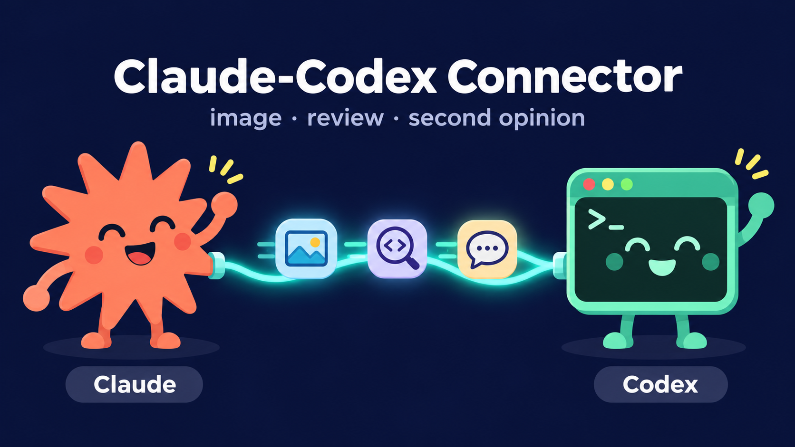

# Claude-Codex Connector

<p align="center"></p>

Let **Claude Code** use **Codex (OpenAI)** through your existing ChatGPT subscription: **generate images**, **review code**, and get a **second/third opinion**. No API keys, no extra servers, and it does not edit your Claude or Codex settings files.

Three skills:

| Skill | What it does | Codex access |
|---|---|---|
| `codex-image` | Codex draws, Claude gets the PNG | writes only in `~/codex-images` |
| `codex-review` | Codex reviews your `git diff` as an independent reviewer | **read-only** |
| `codex-opinion` | Codex gives an independent opinion on a question/design/plan | **read-only** |

Claude verifies Codex's findings and treats its output as untrusted advice.

Not affiliated with Anthropic or OpenAI. MIT licensed.

## Principle: Claude stays in charge

Codex is a tool, not the decision-maker. Each skill makes Claude, unprompted: check image output and revise the prompt itself (up to 2 retries); label every Codex review finding (confirmed / false positive / unverified) and re-ask once if vague; judge Codex's opinion, verify its claims and give its own recommendation. The banner above was made with `codex-image` and passed Claude's check. The characters are original art, not official Anthropic or OpenAI logos.

## Requirements

macOS or Linux, Node.js 18+, Claude Code, a ChatGPT account whose plan includes Codex image generation (not verified for every plan; test with one image).

## Install

```bash
git clone https://github.com/alfeusaditya-cyber/claude-codex-connector.git
cd claude-codex-connector
bash install.sh          # options: --yes, --check, --uninstall
```

Start a new Claude Code session and try: "generate an image of a red apple", "ask Codex to review my uncommitted diff", "get a second opinion from Codex on X".

## Docs

[Guide](docs/GUIDE.md) · [Security notes](docs/SECURITY.md) · [Troubleshooting](docs/TROUBLESHOOTING.md) · [Uninstall](docs/UNINSTALL.md) (docs are in Indonesian)

## Warnings

- Prompts, code diffs and attached files go to OpenAI. Never include secrets or confidential material. A secret scan blocks obvious cases but is only a heuristic.
- Every call uses Codex quota (an image ~28k tokens in testing).
- The Codex `workspace-write` sandbox is not full isolation. See [docs/SECURITY.md](docs/SECURITY.md).
- Check OpenAI's terms for automated use of subscriptions.

## Test

```bash
bash tests/test.sh   # offline, uses a fake codex
```
