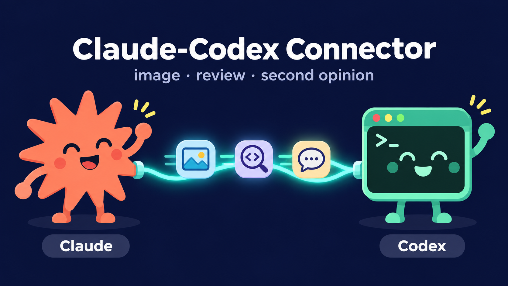

# Claude-Codex Connector

<p align="center"></p>

Let **Claude Code** use **Codex (OpenAI)** through your existing ChatGPT subscription: **generate images**, **review code**, and get a **second or third opinion**. No API keys, no extra servers, and it never edits your Claude or Codex settings files.

> Bahasa Indonesia: [README.id.md](README.id.md)

## Three skills

| Skill | What it does | Example request | Codex access |
|---|---|---|---|
| `codex-image` | Codex draws, Claude gets the PNG | "Make a logo of an astronaut cat" | writes only in `~/codex-images` |
| `codex-review` | Codex reviews your `git diff` as an independent reviewer | "Ask Codex to review my changes" | **read-only** |
| `codex-opinion` | Codex gives an independent opinion on a question, design or plan | "Get a second opinion from Codex: Postgres or SQLite?" | **read-only** |

```
You --> Claude Code --(skill)--> codex exec (sandboxed) --> answer / file
```

Not affiliated with Anthropic or OpenAI. MIT licensed.

## Principle: Claude stays in charge

Codex is a tool, not the decision-maker. Each skill makes Claude do this **without being asked**:

- **codex-image**: inspect the image (exact text, style, composition, artifacts) and revise the prompt itself, up to 2 retries, then report what was fixed.
- **codex-review**: review the diff itself, label every Codex finding (confirmed / false positive / unverified), and re-ask once if the answer is vague.
- **codex-opinion**: judge Codex's answer, verify its claims, re-ask once if vague, then give **its own** recommendation.

The banner above was made with `codex-image` and passed Claude's check. The two characters are original art, not official Anthropic or OpenAI logos.

## Models and plans

Claude picks a depth per task: `quick` (Luna) for small things, `normal` (your own Codex default), `deep` (`gpt-6.2-sol`) for large or risky work. **Free plan** (Luna only): run `bash install.sh --plan free` once and every call uses Luna. Details in [docs/GUIDE.md](docs/GUIDE.md#models-and-plans).

## Requirements

| Need | Notes |
|---|---|
| macOS or Linux | Windows is not supported yet (see [docs/GUIDE.md](docs/GUIDE.md#windows)) |
| Node.js 18+ | https://nodejs.org |
| Claude Code | already installed |
| ChatGPT account | a plan that includes Codex and image generation. **Not verified for every plan**; test with one image |

## Install (one command)

```bash
git clone https://github.com/alfeusaditya/claude-codex-connector.git
cd claude-codex-connector
bash install.sh
```

The installer will:
1. check Node.js,
2. install `@openai/codex` if missing, and **ask first** before changing anything outside the skill folders,
3. help you run `codex login` (browser sign-in, you do it),
4. copy the three skills to `~/.claude/skills/` and create `~/codex-images`.

Then **start a new Claude Code session** and try:

> "Generate an image of a red apple on a white background"
> "Ask Codex to review my uncommitted changes"
> "Get a second opinion from Codex on this approach: ..."

Installer options: `--yes` (answer yes to everything), `--check` (report only, change nothing), `--plan free|paid`, `--uninstall`.

## Documentation

- [docs/GUIDE.md](docs/GUIDE.md): usage, prompt tips, how it works, manual install step by step
- [docs/SECURITY.md](docs/SECURITY.md): **read this**: warnings, what is sent where, sandbox limits
- [docs/TROUBLESHOOTING.md](docs/TROUBLESHOOTING.md): common errors (including npm `EACCES`)
- [docs/UNINSTALL.md](docs/UNINSTALL.md): clean removal
- [CONTRIBUTING.md](CONTRIBUTING.md) · [CHANGELOG.md](CHANGELOG.md) · [SECURITY.md](SECURITY.md)

## Warnings

- Prompts, **code diffs** and attached files are sent to OpenAI. Do **not** include secrets, API keys, or confidential client code/data. Review and opinion scan for secret patterns and refuse to send, but that is only a heuristic.
- Every call uses your Codex quota (one image was about 28k tokens in our tests).
- The Codex sandbox (`workspace-write` for images, `read-only` for review/opinion) limits writing, not reading, and is not full isolation. See [docs/SECURITY.md](docs/SECURITY.md).
- Automating a subscription through a CLI is subject to OpenAI's terms. Check them yourself.

## Why not a bigger multi-AI bridge?

This repo is deliberately small: **Codex only, three tasks, tight sandbox** (images: write in one folder; review/opinion: read-only). No global hooks, no other AI running without permission, no changes to your Claude/Codex configuration. The reasoning is in [docs/SECURITY.md](docs/SECURITY.md#why-so-narrow).

## Test

```bash
bash tests/test.sh
```

Runs offline with a fake `codex`; no network, no quota.

## License

[MIT](LICENSE)
